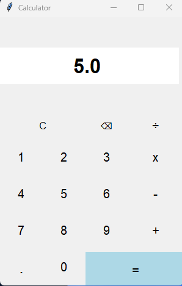

# py-calculator

A simple desktop calculator built with Python and Tkinter.



## Features
- Addition, subtraction, multiplication and division
- Clear (C) and backspace (⌫) buttons
- Error messages for division by zero and invalid input

## Run it
Requires Python 3 (Tkinter is included with the standard install).

```
python calc.py
```

## What I learned
- Building a GUI with Tkinter
- Handling user input and errors
